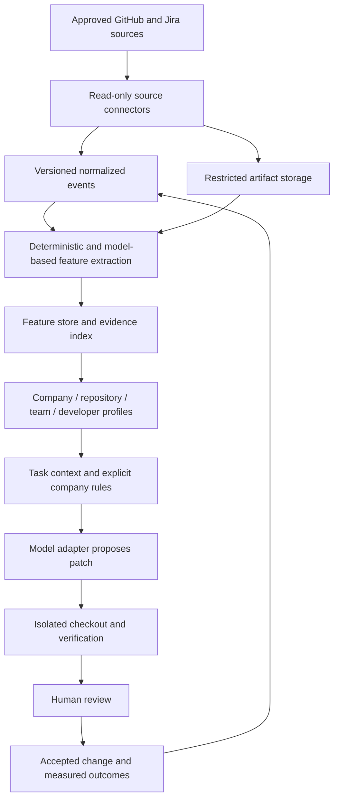

# Architecture

## Target system

This diagram is the target design. Implemented modules are the local source scanner, descriptive profiler, task-context preparation, ingestion-contract validation, and a pure verification-policy function. Connector, storage, model, sandbox, review, and learning services remain to be built.

## Components and contracts

| Component | Responsibility | Initial location |
| --- | --- | --- |
| Domain | Evidence, observations, profiles, task requirements | `src/intap/domain.py` |
| Local ingestion | Bound reads to configured Python source scope | `src/intap/ingestion.py` |
| Profiling | Count four observable function-level patterns | `src/intap/profiling.py` |
| Task preparation | Join company rules, task, and same-company profile | `src/intap/agent.py` |
| Model gateway | Return a patch proposal without applying it | `ModelGateway` protocol |
| Sandbox runner | Verify a proposal in an isolated environment | `SandboxRunner` protocol |
| Evaluation | Block failed verification; otherwise require human review | `src/intap/evaluation.py` |
| Ingestion contract | Validate event shapes, feature definitions, and semantic invariants | `schemas/` and `src/intap/contracts.py` |

## Storage and infrastructure direction

Start with a relational event/feature store and restricted object storage for source artifacts. Add vector retrieval when evidence retrieval needs it. Preserve immutable event revisions, extractor versions, and feature lineage. Use a job queue for connector backfills and extraction; make jobs idempotent by tenant, source instance, object ID, source revision, and extractor configuration.

Introduce an API and user interface after the offline replay path is reliable. Infrastructure dependencies and a model provider are intentionally not selected by the starter implementation.

## Trust boundaries

Tenant identity must come from authenticated server context in the future ingestion API, not merely a caller-supplied JSON field. Enforce tenant scoping in storage queries, artifact access, retrieval, queues, and audit records. The JSON contract and local CLI are not authentication or authorization systems.

Keep verified identity mapping separate from public profile documents. Use pseudonymous developer IDs; do not copy personal email addresses into features. Retention and deletion must propagate to raw artifacts, derived features, embeddings, profile snapshots, and backups according to the company's policy. Schema fields describe that policy but do not enforce it.

Repository text, PR comments, and tickets are untrusted data. System instructions and explicit company policy come from a separate trusted configuration. The future executor must restrict filesystem paths, tool access, network access, resource consumption, and secrets independently of any model instruction. The starter's `capabilities` dictionary is descriptive, not a security mechanism.

Verification reports must eventually be bound to the tested patch hash, base revision, runner identity, and test logs. The current pure gate function consumes supplied booleans; it does not establish that any test or security scan actually ran.

## Learning and evaluation

Use retrieval and explicit profiles before considering fine-tuning. Keep observations and approved rules separate. Profile changes need evidence, versioning, and a way for the developer or team to correct attribution and outdated conventions.

Build chronological train, calibration, and evaluation splits by task, grouping all revisions of the same PR/ticket. At replay time, retrieve only events and features available at the task cutoff. Compare against repository/team baselines to separate personal tendencies from shared constraints. Keep business outcomes and delayed defect labels outside the feature set used to predict the original change.
